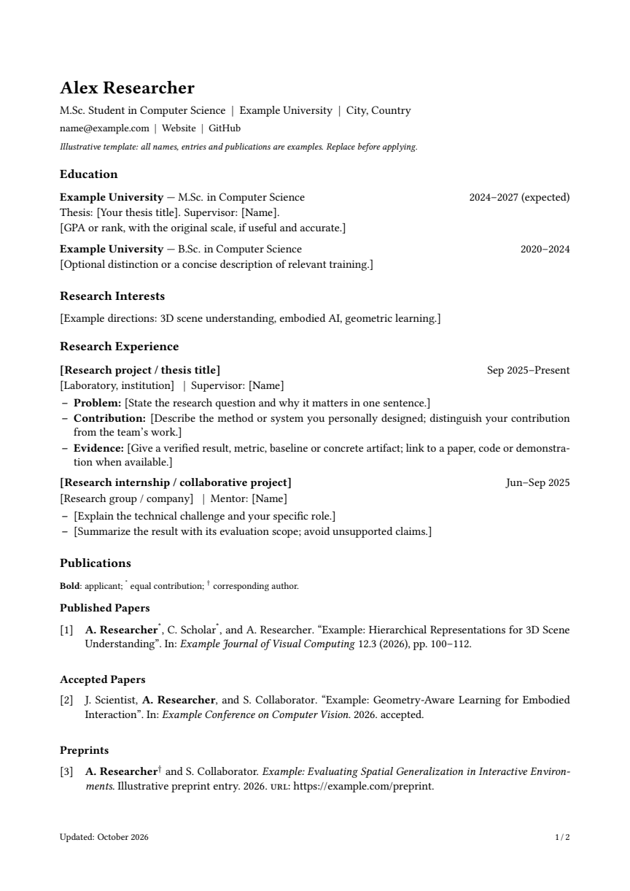

# Personal Academic CV Template

A minimal academic CV template for Computer Science graduate students applying to PhD programmes in Europe. It combines Xovee's single-column layout with publication management inspired by CurVe.

**All names, institutions, experiences and publications are examples. Replace and verify them before using this template for an application.**

## Features

- A4 paper, 11 pt text, a black-and-white single-column layout, and clickable contact and project links.
- One `.bib` database for published papers, accepted papers, preprints and manuscripts under review, displayed in separate groups.
- Selected application and full master versions share the same source files, with consistent typography and natural pagination as content changes.
- Author-name highlighting, equal-contribution (`*`) and corresponding-author (`†`) markers, with explicit overrides for ambiguous names.
- Separate files for personal details, experience sections and publications, plus a bibliography data checker.

## Quick Start

1. Select **Code → Download ZIP**, then import the archive into Overleaf using **Upload Project**. Alternatively, clone the repository and compile locally.
2. Edit `profile.tex` to update your name, contact details, personal links and author-name aliases.
3. Replace the example content in `sections/` and `publications.bib`.
4. Use `main.tex` for the selected application version, or `cv-full.tex` for the full master version. Compile with pdfLaTeX and Biber.
5. After replacing all example content, set `\CVTemplatefalse` in `cv-settings.tex` to hide the template notice.

See the [detailed usage guide (Chinese)](README-中文.md) for configuration, publication status tags and author-name disambiguation. For local builds, run `./build.ps1` to generate both PDFs.

## Preview

[Selected application CV](output/pdf/cv-selected.pdf) · [Full master CV](output/pdf/cv-full.pdf)

Both example versions currently span two pages. Your actual page count depends on the content; follow the requirements of the programme you are applying to.

## Project Structure

| File | Purpose |
| --- | --- |
| `profile.tex` | Personal details and author-name aliases |
| `cv-settings.tex` | Content visibility and template-notice settings |
| `main.tex` / `cv-full.tex` | Entry points for the selected and full versions |
| `sections/` | Education, research, awards, skills and other sections |
| `publications.bib` | Single publication database |
| `personal-cv.sty` | Custom layout and publication-management rules |
| `tools/check_data.py` | Checks for missing or conflicting status tags and duplicate keys |

## Validation and Sources

The examples were compiled locally with TeX Live and Biber. Publication filtering, author-name formatting and PDF layout were checked. Overleaf upload and compilation have not been tested. The included content is illustrative rather than an applicant's actual CV.

The visual foundation is [Xovee's CV Template](https://github.com/Xovee/latex-cv); its original style file and [MIT license](LICENSE-Xovee.txt) are retained. Publication management was inspired by [A Customised CurVe CV](https://www.overleaf.com/latex/templates/a-customised-curve-cv/mvmbhkwsnmwv); this project does not use the CurVe document class. See [sources and licensing](SOURCES-AND-LICENSES.md) for details.